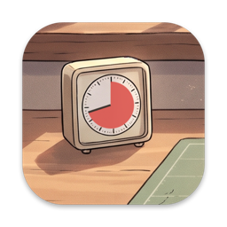
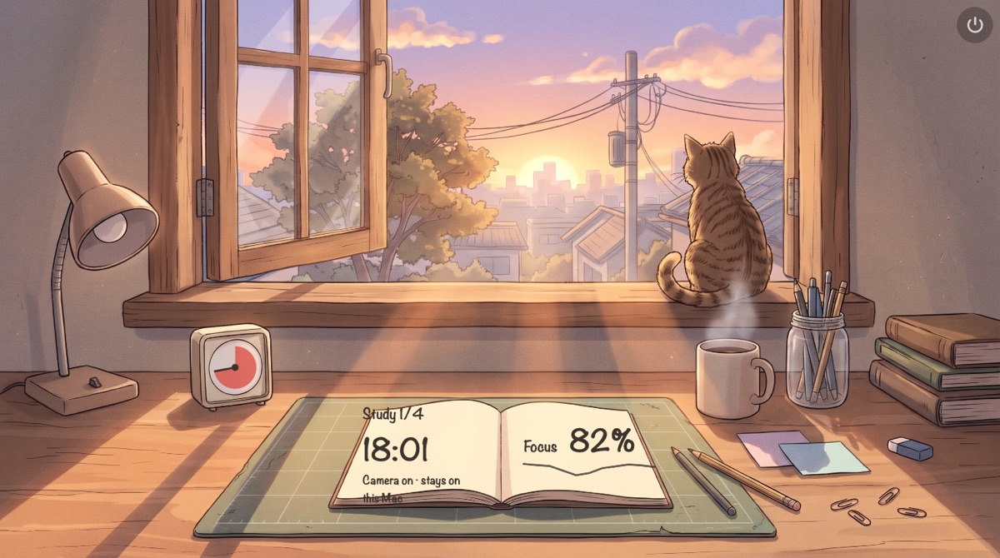
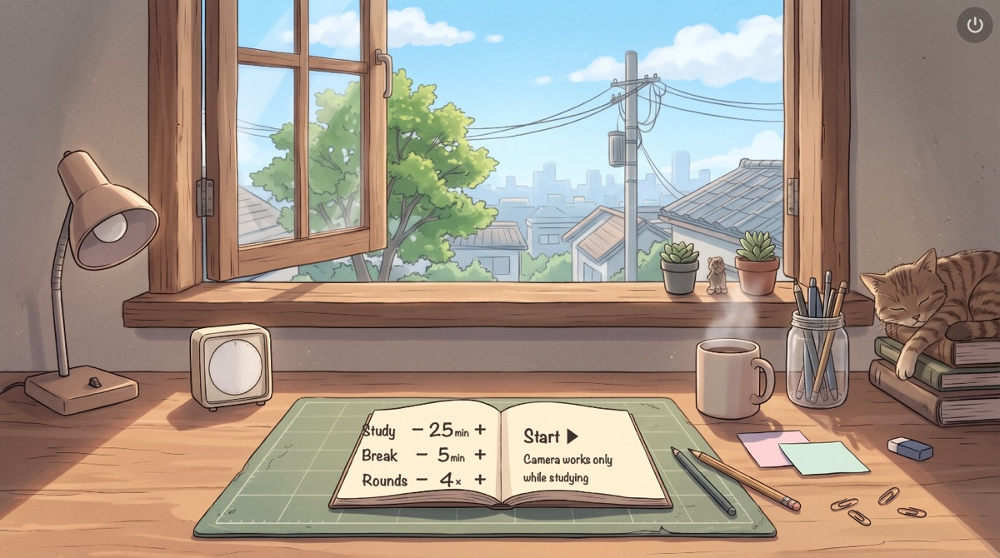
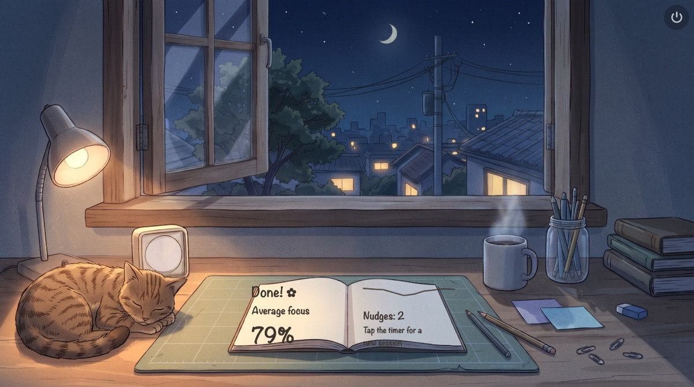

# FocusGuard

A cozy lofi study timer that lives in your Mac's menu bar. While you study, it uses the webcam and Apple's on-device face models to estimate your focus. When your focus drops for real, not for a second, you get a gentle nudge.



| Set up a session | Session summary | A nudge |
| --- | --- | --- |
|  |  |  |

## Features

- **Menu bar app.** Click the timer icon in the menu bar to open a hand-drawn desk scene. The time of day outside the window follows your clock: morning, day, sunset, or night.
- **Pomodoro timer.** Click the kitchen timer on the desk, then set study length, break length, and rounds in the notebook.
- **Focus estimate.** During study phases the camera measures eye openness, gaze, and head pose. The notebook shows your focus percentage and a pencil-drawn chart.
- **No spam.** A nudge needs a sustained drop. A one-second dip never triggers one, and a cooldown keeps reminders rare. Sensitivity is one slider (the sticky note).
- **Camera only while studying.** The camera is off during breaks, while paused, and when no session is running.
- **Pet the cat.** Click or stroke the cat for hearts and a purr. The cat breathes, and the coffee steams.
- English and Polish.

## Privacy

Camera frames are analyzed in memory on your Mac with Apple's Vision framework, then thrown away. Nothing is recorded, saved, or sent over the network. The app makes no network requests.

## Install

1. Download `FocusGuard.zip` from [Releases](../../releases) and unzip it.
2. Move `FocusGuard.app` to Applications.
3. Open it. The app is free and open source but not notarized by Apple, so macOS blocks the first launch:
   - **macOS 15 Sequoia and later:** after the warning, open **System Settings › Privacy & Security**, scroll down, and click **Open Anyway** next to FocusGuard.
   - **macOS 14:** right-click the app, choose **Open**, and confirm.
   - Or remove the download quarantine in Terminal: `xattr -dr com.apple.quarantine /Applications/FocusGuard.app`
   - Or build it yourself (below). Local builds don't get this warning.
4. Look for the timer icon in the menu bar. The app has no Dock icon or window of its own.
5. Allow camera access when you start your first study session. If you denied it, enable FocusGuard in **System Settings › Privacy & Security › Camera**. The timer works without the camera, but focus tracking won't.

To quit, use the ⏻ button in the top-right corner of the scene, or press ⌘Q while it's open.

Requires macOS 14 or later.

## Build from source

You need the Xcode Command Line Tools (`xcode-select --install`). The full Xcode app is not required.

```sh
swift run focus-check        # self-checks for the focus logic and timer
scripts/build-app.sh         # builds dist/FocusGuard.app
open dist/FocusGuard.app
```

Developer extras:

```sh
swift run FocusGuard --snapshots /tmp/fg   # render the scene in key states to PNGs (debug builds only)
swift scripts/make-icon.swift              # regenerate Resources/AppIcon.icns from the art (run from the repo root)
```

## How the focus score works

Each camera frame (about 10 per second) is classified as one of these states:

- **focused**,
- **looking away** (head turned or gaze off-center, compared with a 10-second calibration at the start of each study phase),
- **eyes closed** (longer than 0.5 s, so blinks don't count),
- **absent** (no face).

The score is the share of focused frames in a sliding window. A nudge fires only when all of these hold:

- the score has stayed below the threshold for a while,
- you are still distracted right now,
- the cooldown since the last nudge has passed.

The approach follows [Driver-State-Detection](https://github.com/e-candeloro/Driver-State-Detection) by Ettore Candeloro (MIT). See [the design spec](docs/superpowers/specs/2026-10-13-focusguard-design.md) for the numbers.

If you study from paper on your desk, looking down may count as looking away. Lower the sensitivity in that case.

## Credits

- Illustrations were generated with Google Gemini from prompts written for this project.
- Focus heuristics were inspired by [e-candeloro/Driver-State-Detection](https://github.com/e-candeloro/Driver-State-Detection) (MIT).

## License

[MIT](LICENSE)
