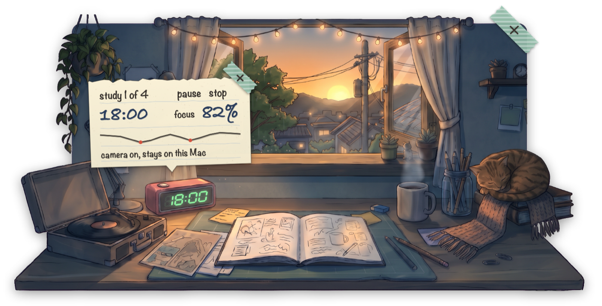
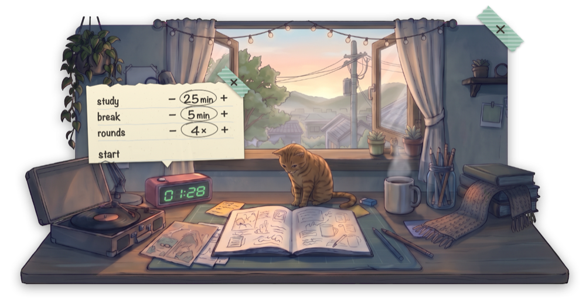
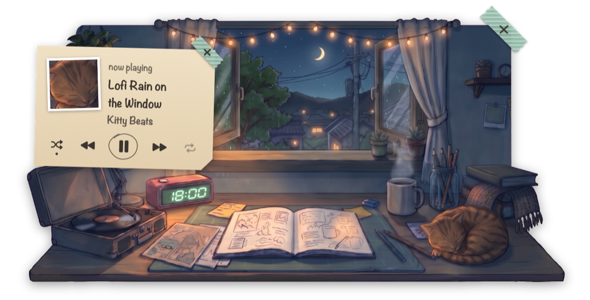
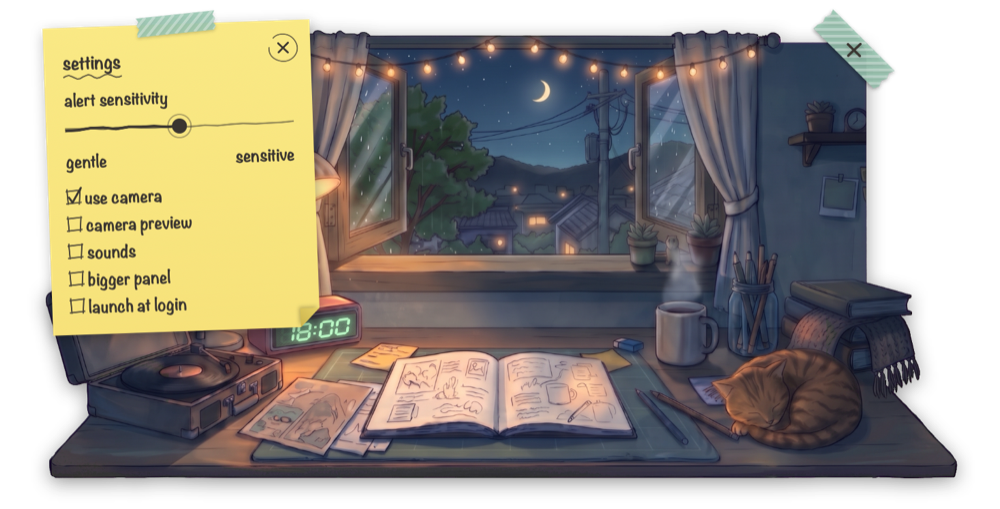
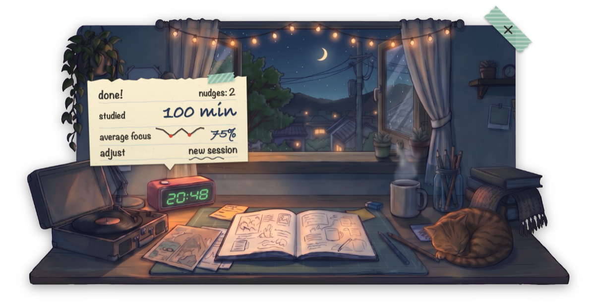
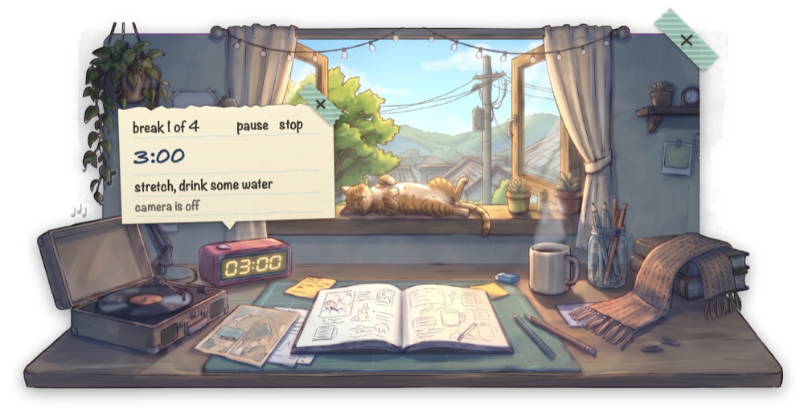
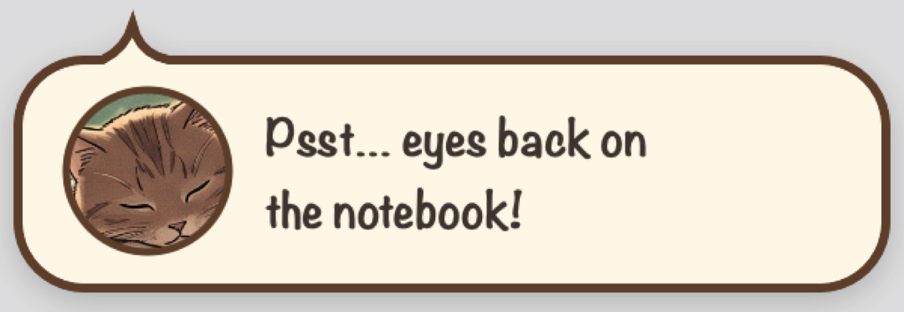

# FocusGuard

**A cozy lofi study timer that lives in your Mac's menu bar.**

Click the timer icon and a hand-drawn desk opens under it: a window onto the town, a lamp, a record player, a mug of coffee, and a cat asleep on the books. Click the desk clock to start a Pomodoro session. While you study, FocusGuard can use the webcam and Apple's on-device face models to estimate your focus. When your focus really drops, not for just a second, the cat gives you a gentle nudge.



<table>
  <tr>
    <td width="50%"><br><sub><b>Set up and start</b>: study, break and rounds right on the card.</sub></td>
    <td width="50%"><br><sub><b>Spotify on the record player</b>: track, cover and controls.</sub></td>
  </tr>
  <tr>
    <td><br><sub><b>Settings</b> on a sticky note: sensitivity, camera, sounds.</sub></td>
    <td><br><sub><b>Summary</b>: minutes studied, average focus, nudges.</sub></td>
  </tr>
  <tr>
    <td><br><sub><b>Breaks</b>: the camera is off, the cat stretches out on the sill.</sub></td>
    <td><br><sub><b>A nudge</b> when your focus stays low.</sub></td>
  </tr>
</table>

## Features

### The desk
- **Lives in the menu bar.** No Dock icon and no window of its own. Click the menu bar icon, or press **⌃⌥⌘F** anywhere, to open the desk.
- **The sky follows your clock.** The view outside the window changes with the time of day: morning, day, sunset and night.
- **Everything on the desk does something.** Hover over an object to see its outline, then click it:

  | Object | What it does |
  | --- | --- |
  | Desk clock | Starts a session. During a session it pauses or resumes. |
  | Mug | Pauses or resumes. |
  | Sticky notes on the wall | Open the settings. |
  | Record player | Opens Spotify's now-playing note. |
  | Cat | Pet it for hearts and a written *prrr~*. |

- **Small, calm motion.** The cat breathes, the coffee steams, and the record spins while music plays. With **Reduce Motion** turned on, the decorative motion stops.

### The timer
- **Settings right on the card.** Before a session, the paper card above the clock shows study length, break length and the number of rounds, each with − and +. Click **start**, or click the clock.
- **Pause and stop in one click.** During a session, the card shows the time left with **pause** and **stop**. Space also pauses, and so do the clock and the mug.
- **A clean view when you want it.** Every card and note is held by washi tape with a pencil ×. Click the × to put the card away while the session keeps running. Click the clock to bring it back.
- **Long breaks.** In a session with more than 4 rounds, the break after every 4th round is three times as long (at most 30 minutes).
- **A summary at the end.** You see minutes studied, your average focus with a small chart, and how many nudges you got.

### Focus tracking (optional)
- **Estimates focus from the camera.** During study phases, FocusGuard checks eye openness, gaze and head pose about 10 times a second. The card shows a focus percentage and a pencil-drawn chart.
- **Never guesses.** When the camera cannot see your eyes clearly, the figure is hidden instead of guessed.
- **No spam.** You get a nudge only after a sustained drop: a speech bubble from the cat, or a red line on the open card, with a soft sound if sounds are on. A one-second glance away never triggers one, and a cooldown keeps reminders rare.
- **Camera only while you study.** The camera is off during breaks, while paused, and when no session runs. To use FocusGuard as a plain timer, untick **use camera** in the settings.

### Spotify
- Click the record player to see the track, artist and album cover, with play/pause, previous, next, shuffle and repeat.
- macOS asks once whether FocusGuard may control Spotify. FocusGuard never starts Spotify on its own.

### More
- **Bigger panel.** One setting draws the whole desk 25 % larger.
- **Launch at login**, from the settings.
- **Keyboard support.** Tab moves between controls, Space pauses, Esc steps back one layer, ⌘W hides the panel, ⌘, opens the settings, and ⌘Q quits.
- **Languages:** English and Polish.

## Install

Requires **macOS 14 Sonoma or later**, on Apple silicon or Intel.

### Download

1. Download `FocusGuard.zip` from [Releases](../../releases) and unzip it.
2. Move `FocusGuard.app` to **Applications**.
3. Open it. FocusGuard is free and open source but not notarized by Apple, so macOS blocks the first launch. To open it anyway, choose one option:
   - **macOS 15 Sequoia and later:** after the warning, open **System Settings › Privacy & Security**, scroll down, and click **Open Anyway** next to FocusGuard.
   - **macOS 14:** right-click the app, choose **Open**, and confirm.
   - **Terminal:** run `xattr -dr com.apple.quarantine /Applications/FocusGuard.app`.
4. Look for the timer icon in the menu bar.
5. Allow camera access when you start your first study session, if you want focus tracking. If you said no, turn FocusGuard on later in **System Settings › Privacy & Security › Camera**. The timer works without the camera.

### Build from source

You need the Xcode Command Line Tools (`xcode-select --install`). The full Xcode app is not required. A local build does not trigger the Gatekeeper warning.

```sh
git clone https://github.com/fidok15/FocusGuard.git
cd FocusGuard
swift run focus-check        # self-checks for the focus logic, timer and Spotify parsing
scripts/build-app.sh         # builds dist/FocusGuard.app
open dist/FocusGuard.app     # or move it to /Applications first
```

### Quit or uninstall

To quit, press **⌘Q** while the desk is open, or right-click the menu bar icon and choose **Quit FocusGuard**. To uninstall, quit FocusGuard and delete `FocusGuard.app`.

## Privacy

- Camera frames are analyzed in memory on your Mac with Apple's Vision framework, then thrown away. Nothing is recorded, saved or uploaded.
- The only network traffic is for the album cover of the song Spotify is playing. FocusGuard looks up the cover link on `open.spotify.com` and downloads the image from Spotify's image server.

## How the focus score works

Each camera frame is classified as one of four states:

- **focused**
- **looking away**: head turned or gaze off center. Each study phase starts with a 10-second calibration, and these are measured against it. Places you keep looking at, like a second monitor or a laptop beside it, become work zones after about a minute and then count as focused.
- **eyes closed**: closed for longer than 0.5 s, so blinks don't count.
- **absent**: no face in the frame.

The score is the share of focused frames in a sliding window. A nudge fires only when all three conditions hold:

1. The score has stayed below the threshold for a while.
2. You are still distracted right now.
3. The cooldown since the last nudge has passed.

The sensitivity slider moves the threshold. If you study from paper on your desk, looking down may count as looking away. In that case, lower the sensitivity.

The approach follows [Driver-State-Detection](https://github.com/e-candeloro/Driver-State-Detection) by Ettore Candeloro (MIT). [How FocusGuard scores focus](docs/focus-scoring.md) has the exact numbers.

## For developers

| Path | Contents |
| --- | --- |
| `Sources/FocusCore` | UI-free logic: the session clock, the focus scorer and Spotify parsing. |
| `Sources/FocusGuard` | The menu bar app: SwiftUI scene, panel, camera and Spotify. |
| `Sources/focus-check` | Self-checks for FocusCore, run in CI. |
| `art/` | The four time-of-day scenes. |
| `scripts/` | App bundle build and icon generation. |

Debug builds have a few extras:

```sh
swift run FocusGuard --snapshots /tmp/fg                 # render key states to PNGs
swift run FocusGuard --window night --state music        # the scene in a plain window, in a given state
swift scripts/make-icon.swift                            # regenerate Resources/AppIcon.icns (run from the repo root)
```

Pushing a `v*` tag that matches the version in `Resources/Info.plist` builds the app in CI and publishes a GitHub release.

## Credits

- Illustrations were generated with Google Gemini from prompts written for this project.
- Focus heuristics were inspired by [e-candeloro/Driver-State-Detection](https://github.com/e-candeloro/Driver-State-Detection) (MIT).

## License

[MIT](LICENSE)
